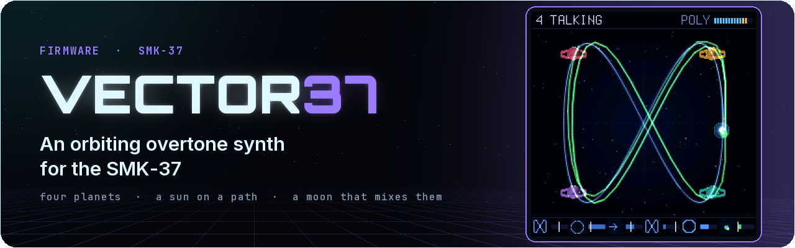
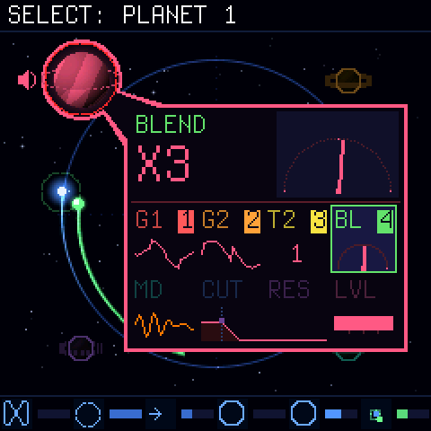

<p align="center"></p>

# Vector37

**Watch it:** [Vector37 0.3 on YouTube](https://youtu.be/gr2IwKLuwZo) · **Try it:** [in your browser](https://genkigenki.github.io/smk37/vector37-sim/) · **Install:** <https://genkigenki.github.io/smk37/#fw-vector37>


**An orbiting overtone synth for the M-Vave SMK-37** (and, experimental, the FM-1).
Four corners, each two overtone generators, a blend and a filter. A sun runs along a path, a moon circles it, and
where the moon is decides how much of each corner you hear. One screen: the orbit, a small universe with a planet
in each corner. The pads and the knobs are the planets (four pad groups of 2 x 2; eight knobs for the selected
planet's sound: the planet draws them, and you hear it alone while you change it), the four faders are the path
(family, size, speed, morph: they glide to where you move them).
Thirty-two factory sounds in two banks (FACTORY, and FACTORY 2: the basics, pads, strings, choir, organ, keys,
basses, sequences, brass, a lead, wind and drums, each a whole scene) and a USER bank of sixteen of yours, one a pad:
PATCH opens the sound list (a pad: play; held 1 s: SAVE there; < > the sounds of the bank). Wavetables: each generator can read one of eight banks of 32 frames, and the moon moves its
place as it nears the planet (SCALE: the WAVE knobs). The 3.5 mm MIDI jack sends the keys and wheels as played
(TRS MIDI OUT; BT, the SETUP set: its channel, the USB MIDI IN channel, the pad light 25 .. 100 %, the sound at power-on). The knob
sets (CHORD, FX, FADER BANK, ARP, SCALE, BT) open with a
tap and stay open until tapped again.
Unofficial firmware, not affiliated with or endorsed by M-Vave. Install at your own risk.

[Control map](docs/CONTROLS.md) · [Design](docs/DESIGN.md) · [On the FM-1](#on-the-fm-1-experimental)

## Install

- **Python:** connect the SMK-37 by USB, then

  ```
  python tools/fm1_install.py --yes vector37.fwsc
  ```

Installing clears another firmware's stored data on the keyboard (and the other way round).
To go back to the stock firmware, install it the same way. Rescue: hold OCT - while switching on.
The SMK-37 Elite and the MKE-P37 take vector37-elite.fwsc / vector37-mke.fwsc.

## On the FM-1 (experimental)

**Untested on a unit.** vector37-fm1.fwsc is the same synth and screen for the M-Vave FM-1 (identity FM-1_700, the
FM-1's flash layout and update loader). It is built and checked on the host (its panel, its screens, its flash
guard, the package), but nobody has played it on an FM-1 yet: install it only if you can go back (the stock
firmware or Felucca installs the same way; rescue: hold OCT- while switching on; OCT- + OCT+ held 5 s: the update
mode). Reports welcome.

The FM-1 has four knobs, no pads, faders or wheels, so their jobs move:

| SMK-37 | FM-1 |
|---|---|
| K1..K8 | KNOB 1..4 on page 1 (K1..K4) and page 2 (K5..K8); SEL: the next page, SELECT turns them, HOME: page 1. The screen tags the four knobs in play with 1..4 and dims the other row |
| Faders: FAMILY, SIZE, SPEED, MORPH | page 3, the PATH: KNOB 1..4 |
| Mod wheel: MOON SPEED | the ORBIT set (no planet selected), page 2, KNOB 4 (BPM: the ARP set, or PLAY) |
| SELECT pads: the planet | ALGORITHM: none, 1, 2, 3, 4 |
| The 16 pads (SELECT, MODE, FILTER, MUTE) | EDIT held: the lowest 16 keys, four groups of four, the same order; their LEDs show the pads' state |
| < > | PRESETS |
| CHORD, FX, FADER BANK, ARP: the knob sets (a tap opens one, again closes) | ENV, FX, LFO, ARP, the same (SEL still turns the page) |
| SEQ, REC, PLAY, GLOBE, PARA | SEQ, REC, PLAY, GLO, SAVE (the same jobs) |
| REPEAT (RESTART), PATCH twice (all notes off) | EDIT + PLAY, EDIT + SEQ |
| 37 keys with velocity | 27 keys (F3..G5), velocity 100; their LEDs light the notes held |
| Volume | MASTER (the pot) |
| TRS MIDI OUT, KNOB BANK (the guide), SAVE and the SETUP set | none (the FM-1's jack is MIDI IN; no store of its own, below) |

Vector37 keeps no data of its own on the FM-1 and writes only its update staging: another firmware's store
(Felucca's projects and settings) stays as it was. The full map: [docs/CONTROLS.md](docs/CONTROLS.md#on-the-fm-1-experimental).



## Build

```
sh build.sh                        # Linux / WSL: JieLi toolchain (tools/get_toolchain.sh)
MODEL=elite sh build.sh            # (or mke) the same for the SMK-37 Elite / the MKE-P37
BOARD=fm1 sh build.sh              # the FM-1 (experimental): build/vector37-fm1.fwsc
sh tests/run_tests.sh OUTDIR       # engine renders, every control on the screen, board layer tests
sh web/sim/build.sh                # the simulator (Emscripten), then serve build/sim
sh tools/docs_img.sh               # the screenshots and the animation in docs/img
```

## Credits

Inspired by the Beetlecrab Vector and its Orbiter.
Board layer from SLOOP by isod89, based on Felucca by Leo Kuroshita. Master stage after Melodee by Kerem Kilic
(GPL-3.0). Plate after J. Dattorro, "Effect Design 1" (1997). Terminus font (SIL OFL 1.1).
ref/ holds the Vector manual for reference only (CC BY-SA 4.0, Beetlecrab s.r.o.); it is not part of the firmware.

By genkigenki. Licence: GPL-3.0 (see [LICENSE](LICENSE)).
