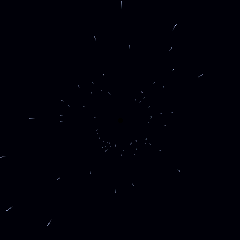

# Vector37



**An orbiting overtone synth for the M-Vave SMK-37 Pro.**
Four corners, each two overtone generators, a blend and a filter. A sun runs along a path, a moon circles it, and
where the moon is decides how much of each corner you hear. One screen: the orbit, a small universe with a planet
in each corner. The pads and the knobs are the planets (four pad groups of 2 x 2; eight knobs for the selected
planet's sound: the planet draws them, and you hear it alone while you change it), the four faders are the path
(family, size, speed, morph: they glide to where you move them).
Eight sounds on < >. The 3.5 mm MIDI jack sends the keys and wheels as played (TRS MIDI OUT, channel 1; ARP held,
K8: on / off).
Unofficial firmware, not affiliated with or endorsed by M-Vave. Install at your own risk.

[Control map](docs/CONTROLS.md) · [Design](docs/DESIGN.md)

## Install

- **Python:** connect the SMK-37 Pro by USB, then

  ```
  python tools/fm1_install.py --yes vector37.fwsc
  ```

Installing clears another firmware's stored data on the keyboard (and the other way round).
To go back to the stock firmware, install it the same way. Rescue: hold OCT - while switching on.

## Build

```
sh build.sh                        # Linux / WSL: JieLi toolchain (tools/get_toolchain.sh)
sh tests/run_tests.sh OUTDIR       # engine renders, every control on the screen, board layer tests
sh web/sim/build.sh                # the simulator (Emscripten), then serve build/sim
sh tools/docs_img.sh               # the screenshots and the animation in docs/img
```

## Credits

Inspired by the Beetlecrab Vector and its Orbiter.
Board layer from SLOOP by isod89, based on Felucca by Leo Kuroshita. Master stage after Melodee by Kerem Kilic
(GPL-3.0). Plate after J. Dattorro, "Effect Design 1" (1997). Terminus font (SIL OFL 1.1).

By genkigenki. Licence: GPL-3.0 (see [LICENSE](LICENSE)).
