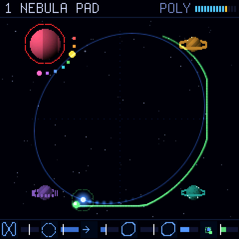

# Vector37: controls

One screen: the orbit. Everything you touch shows up there first.

## The panel in one sentence

The pads and all eight knobs are the planets (the sound of the selected corners); with no planet selected (as after
switching on and after a new sound) the eight knobs are the orbit and the moon; the four faders are the path (its
family, size, speed and shape), the mod wheel the moon's speed; the buttons choose (sounds, modes) and, held, lend
the knobs a second job.

## The screen

| Place | What it shows |
|---|---|
| Top line | what a pad, fader or button just did ("PAD FILTER 3: LP24", "F2 SIZE 80", "HOLD FX: MIXER KNOBS"); otherwise the sound's name, the voice mode and the level. A planet's knob is not named here: it shows in the planet's bubble |
| The orbit (middle, 200 x 200: the whole width but a margin) | four planets = the four corners of the sound; the sun runs along the dotted path, the moon circles it; the moon's place mixes the corners, each planet glows as loud as it is heard. The selected planet is drawn large, in a red ring, turning slowly, its eight settings drawn on it (see "The planet shows its sound"); the others smaller and dimmer |
| A planet's bubble | a speech bubble in the planet's colour, its tail wrapped round the planet: the planet's eight knob settings as an overview (see "The planet's overview"); a pad's list (MODE, FILTER) |
| The central box | in the middle of the orbit, square, blue-white, marked with a small sun: everything that is not one planet's (the path faders; the moon's speed; BPM, the clock; the orbit's knobs (no planet selected) and the knob sets of a held button: voice, mixer, more, arp; tempo, volume, effects) |
| Bottom strip (always) | the path and the moon at a glance, six small pictures with bars: F1 FAMILY (the family's figure), F2 SIZE (a circle as large as the path), F3 SPEED (an arrow, longer when faster), F4 MORPH (the figure now), WARP (a circle bent as the warp bends it), MOON (a moon on its ring: the ring as wide as its distance; the bar its speed). For the faders and the wheel: the bar is the value, the thin tick the control's place; when it leads they meet, while the value glides the bar runs to the tick |

## The rules

1. **The orbit leads.** What you touch shows on the orbit (a planet's bubble, the central box) or in the top line first.
2. **Same place.** The screen's corners are the pads' corners: in each 2x2 pad group, top left is corner 1, top
   right 2, bottom left 3, bottom right 4. The knobs and the faders are shown in their panel order.
3. **Same colour, same thing.** Planets: 1 rose, 2 amber, 3 violet, 4 teal. Pad groups (steady colours, no
   flicker): SELECT blue, MODE orange, FILTER purple, MUTE green. A pressed group's name is shown in its colour.
4. **One press, one step.** A pad does one thing per press: SELECT picks, MUTE switches on / off, MODE and FILTER
   step through their list (wrapping round). The list is shown in the planet's bubble, the current item lit. MUTE
   shows no bubble: the planet itself shows it (switched off: a flash of lightning, then it collapses to a dark
   outline; switched on: it ignites in a burst of light).
5. **The selected corners** show on their SELECT pads (brighter) and on the orbit: their planets zoom up (a short
   animation when picked), with a red ring and satellites; the others shrink and dim a little. A tap on a SELECT
   pad picks that planet alone; a tap on a selected planet's pad takes it out of the selection; holding one SELECT
   pad and pressing another adds it. **Nothing selected: the knobs are the orbit** (switching on and every new sound
   start so), and the orbit shows it is in charge: the path drawn bright with a soft glow, a faint blue haze behind
   the orbit, the sun brighter; picking a planet dims them back to their quiet look (both ways glide in about
   0.2 s). No square is drawn round the orbit: the path is fitted to it, the planets sit at its corners, and the sun,
   the moon and its trail may reach past it into the sky. The SELECT pads then all stay dim (none lit = none selected). A value or
   list for a planet appears in a speech bubble whose tail wraps round that planet, in its colour. **Several selected:** the knobs change them all at once, each from its own value by the same amount
   (clamped; a stepping knob such as GEN, TUNE or MODE steps each one), so their differences stay; one bubble in the
   middle with a tail to each selected planet; in its overview each cell has a track with a dot per planet (in its
   colour) where its value is, so differences show at a glance; a turned knob shows each planet's value in its
   colour.
   **A planet or the sun.** A planet's values (its eight knobs, its mode, filter, mute; also TUNE 1, TRACK and
   FILTER on the MORE set, marked with the planet's dot) belong to that planet: they show in its bubble or in its
   colour. Everything global (the path, the mixer and effects, volume, BPM, the voices, the orbit) shows in the
   central box, never in a planet's bubble.
6. **Hear what you change.** With no key held, changing a planet (a knob or a pad) plays that planet alone (its
   corner soloed, through its blend and filter, a short note at C3), held while you keep turning and released half a
   second after the last change. A small speaker beside the planet shows while it sounds. On / off: FADER BANK held, K8.
7. **Faders and the mod wheel glide to where they are.** A new sound brings its own path and moon speed; the faders
   and the mod wheel leave them alone until one is moved on purpose: then the value glides to that control's place in
   about 0.4 s (the path morphs on the screen) and follows it from then on. A resting fader or wheel never starts a
   glide and never changes a value: a new move counts from 5 steps on (then it follows step by step), so a noisy
   reading at rest does nothing; the wheel's reading is also smoothed. The wheel's box and lit ring show only for a
   move of more than 5 from where it was last shown.
8. **No hidden modes.** A held button lends the eight knobs another job only while held, and the screen shows those
   jobs as long as it is. Whether the knobs are planets or the orbit you see on the screen: planets zoomed up in red
   rings, or none. KNOB BANK opens and closes the guide.

## The table

| Control | Action | The screen shows |
|---|---|---|
| Keys | play (velocity) | a sun and a moon per voice; the level (top right) |
| Pitch wheel | bend, 2 semitones | top line: PITCH BEND |
| Mod wheel | MOON SPEED: how fast the moon circles the sun (the suborbit's speed; only here, one value, one display). The wheel stays where it is put: its place is the value (after a new sound: glides there on its first move, as the faders) | the central box: MOON SPEED, its bar and the wheel's tick; behind the moon a soft line through its real places on the screen (taken every frame: round the sun, as the sun moved) over its last whole turn, at least the last 0.5 s, bright at the moon and fading to dark; top line "MOD MOON SPEED 80" |
| K1-K8, no planet selected | the orbit and the moon: K1 WARP, K2 WARP Y, K3 ROTATE, K4 CONTRAST (how much a planet takes over near it), K5 MOON DIST (the moon's distance from the sun), K6 SPIN (the whole path turns on and on: right of the centre clockwise, left anticlockwise, faster further out, counted in the BPM: at the ends about a turn a beat; centre: still), K7 RESTART (each note starts the path from the beginning), K8 BPM (the clock for the path's speed, the delay and the arpeggiator) | the central box, small (the orbit stays in sight): the knob turned, its name and value large, a line saying what it does; the path lights up while K1-K4 or K6 change it, the moon's ring while K5 does; with SPIN the path keeps turning |
| K1 | GEN 1: the selected planets' first overtone pattern (A-F, N noise) | the planet's bubble: the overview, GEN 1 enlarged (its wave), name and value large ("GEN 1", "C"); the planet pulses |
| K2 | GEN 2: the second pattern | the same, GEN 2 enlarged |
| K3 | TUNE 2: generator 2 at 1, 1/2 .. 1/5 of the note (an octave, a twelfth .. below) | TUNE 2 enlarged: the two waves' ratio, "1/2" |
| K4 | BLEND: left adds GEN 2 (+), centre GEN 1 alone, right modulates (x, by MODE) | BLEND enlarged: a dial from + (add) over G1 to x (modulate); "+40" / "G1" / "x40" |
| K5 | MODE: the modulation, a step a click (AM, PM, PM+AM, PD+AM, rPD+AM) | MODE enlarged: the modulated wave's picture; "PM" |
| K6 | CUTOFF of the selected planets' filters | CUTOFF enlarged: the filter's curve (its type, the cutoff, the resonance's peak); "63" |
| K7 | RESONANCE | the same curve, RESO lit; "40" |
| K8 | LEVEL of the selected planets | LEVEL enlarged: a level bar; "100" |
| Fader 1 | FAMILY: the path families, Lissajous - spiro - star - pulse - ADSR, bottom to top. Detents: the fader's travel is five equal slots, one per family; the middle 70 % of a slot is that family exactly (the fader "clicks in" on a clean figure), the 15 % at each edge morph to the neighbour (both blended, continuous) | the central box: the families as a list that moves with the fader (fader up: the family above comes to the middle), the current one lit in the middle, its neighbours fading above and below, each with its picture; on the right a scrollbar, its thumb one family high, at the fader's place; on a family the row and the thumb lock in (a short flash) |
| Fader 2 | SIZE of the path | the central box: SIZE, the value bar and the fader's tick; "F2 SIZE 80"; the path grows, live |
| Fader 3 | SPEED: the sun's speed, beats a round, 32 .. 1/8, in steps (counted in the BPM; the moon's speed is the mod wheel) | the central box; "F3 SPEED 1/2" |
| Fader 4 | MORPH: the family's shape (Lissajous: frequency ratio; star: points; spiro: loops) | the central box; "F4 MORPH -39"; the path morphs |
| Pad, SELECT group (columns 1-2), blue | tap: that planet alone; tap a selected one: out of the selection (none left: the knobs are the orbit); pressed while another SELECT pad is held: added | the planet zooms up, red ring; its bubble shows its eight settings (the overview); several: one bubble, a tail to each |
| Pad, MODE group (columns 3-4), orange | that corner's modulation, next in the list (as K5) | the list over the orbit, the new item lit; "MODE" in orange |
| Pad, FILTER group (columns 5-6), purple | that corner's filter, next in the list LP12, LP24, BP, HP, VOX, OFF | the list, the new item lit |
| Pad, MUTE group (columns 7-8), green | that corner on / off | no bubble: the planet switched off flashes (a bolt of lightning) and collapses to a dark outline; switched on, it ignites in a burst; its pad red while muted; top line "PAD MUTE 4: MUTE" |
| < > | the previous / next sound | top line: its number and name |
| OCT- / OCT+ | the keys an octave down / up | top line |
| SEQ | tap: FREEZE: the orbit stops where it is (the sound holds its mix; a knob or fader still changes it); tap again: it moves on (the orbit's knobs: with no planet selected) | top line FREEZE, the button lit; the sun and moon stand still |
| CHORD | tap: POLY, DUAL, MONO; held: knobs = VOICE (envelope, detune, glide, stack, stereo) | top line: the mode; held: the central box |
| FX | held: knobs = MIXER (reverb, delay, chorus, drive, reverb size, delay time and feedback, volume) | the central box while held: the eight jobs and values, labels in the knobs' colours; the one turned large |
| FADER BANK | held: knobs = MORE (tune 1, key tracking, filter type, drive colour, chorus depth and speed, reverb colour, audition) | the same (TUNE 1, TRACK, FILTER marked with the planet's dot, in its colour) |
| ARP | tap: the arpeggiator on / off; held: knobs = ARP (mode, BPM, the orbit envelope, bend range, TRS MIDI OUT) | top line: ARP; held: the central box |
| REC | LATCH: notes stay after the keys let go (a new chord replaces them) | its light, top line |
| PLAY | tap the BPM (its light blinks the beat) | top line: BPM |
| REPEAT | RESTART: each note starts the path from the beginning | its light, top line |
| GLOBE | FOCUS: the orbit stands on corner 1, 2, 3, 4, the centre, ...; held: off | the sun and moon on that planet |
| PARA | RANDOMIZE the selected corners; held: UNDO (again: redo) | top line |
| PATCH | all notes off | top line |
| KNOB BANK | the guide (pictures of the panel, the pad groups, the orbit, the shapes); K1 scrolls; KNOB BANK again closes | top line: GUIDE, K1 SCROLLS |

## The knob sets while a button is held

| Held | K1 | K2 | K3 | K4 | K5 | K6 | K7 | K8 |
|---|---|---|---|---|---|---|---|---|
| (none), planets selected | GEN 1 | GEN 2 | TUNE 2 | BLEND | MODE | CUTOFF | RESO | LEVEL |
| (none), no planet selected: ORBIT | WARP | WARP Y | ROTATE | CONTRAST (how much a planet takes over near it) | MOON DIST (the moon's distance from the sun) | SPIN (the path turning on and on, in time) | RESTART | BPM |
| CHORD: VOICE | ATTACK | DECAY | SUSTAIN | RELEASE | DETUNE | GLIDE | STACK | STEREO |
| FX: MIXER | REVERB | DELAY | CHORUS | DRIVE | REVERB SIZE | DELAY TIME | FEEDBACK | VOLUME |
| FADER BANK: MORE | TUNE 1 | TRACK | FILTER | DRIVE COLOUR | CHORUS DEPTH | CHORUS SPEED | REVERB COLOUR | AUDITION (on / off) |
| ARP | MODE | BPM | ORBIT ATTACK | ORBIT DECAY | ORBIT SUSTAIN | ORBIT RELEASE | BEND RANGE | TRS MIDI OUT (ON / OFF) |

## TRS MIDI OUT

The SMK-37's 3.5 mm MIDI jack sends the keyboard as played, on MIDI channel 1: the keys (note on with the key's
velocity, note off; a key let go after OCT- / OCT+ ends the note it started), the pitch wheel (pitch bend, the
centre at rest) and the mod wheel (CC 1). Not the arpeggiator, the latch or the sound itself; USB MIDI out stays
quiet (a computer sending it back would play every note twice).
ARP held, K8: TRS MIDI OUT ON (right) / OFF (left); ON at power-on (not
stored). Should the jack never finish a byte (no UART), it goes quiet after four tries and K8 reads NOT SENDING;
turning it ON again tries again.

DETUNE: POLY a slow drift, DUAL the follower's interval (centre: unison), MONO the stack's spread.
Delay feedback at full: the delay loops.

## The planet's overview

Picking a planet (its SELECT pad) or turning one of its knobs opens its bubble: the eight knob settings in knob
order, two rows of four as on the panel, each a small picture under its short name (in the knob's colour):

| Knob | Picture |
|---|---|
| K1 GEN 1, K2 GEN 2 | the pattern's wave (one period; N: noise) |
| K3 TUNE 2 | the ratio: GEN 2's wave against GEN 1's, 1 .. 1/5 as slow, and the ratio |
| K4 BLEND | a dial: left + (GEN 2 added), top G1 (alone), right x (GEN 2 modulates), the needle where it is |
| K5 MODE | the modulated wave's picture (AM, PM, PM+AM, PD+AM, rPD+AM) and its name, dim while BLEND does not modulate |
| K6 CUTOFF, K7 RESO | one picture over both: the filter's curve (its type), bending at the cutoff, its peak as high as the resonance |
| K8 LEVEL | a level bar |

Picked: the header says SELECT, the planet's number, its filter type (and MUTE). Turned: the header shows that
knob's name and value large beside its picture enlarged, and its cell in the overview is lit.

## The central box

Everything global shows in one place, the middle of the orbit: a square box, blue-white, a small sun in its corner
(the sun is the path; the planets are the corners). A held button: its knob set (the eight jobs, labels in the knobs'
colours, values beneath), the one turned last large on top. The mod wheel moved: MOON SPEED, its bar and the wheel's
tick. A fader moved: its value bar and the fader's tick; for
F1 FAMILY a list of the families that moves with the fader (up: the family above), the current one lit in the middle,
the neighbours fading above and below, each with the family's picture, and a scrollbar whose thumb (one family high)
stands at the fader; on a family's plateau the row and the thumb lock in with a short flash.

## The planet shows its sound

The selected planet is drawn large and turns slowly; its eight settings are features you can see change as you turn
the knobs:

| Knob | Satellite (colour = the knob label's) | On the planet |
|---|---|---|
| K1 GEN 1 | red | the stripes: their number and slant follow the pattern |
| K2 GEN 2 | orange | a second band of stripes, when BLEND lets it in |
| K3 TUNE 2 | yellow | how fast the planet turns (lower generator: slower) |
| K4 BLEND | green | a ring: none at the centre; solid when added (left), dashed when modulated (right); wider with more |
| K5 MODE | cyan | the ring's dash pattern (one per modulation) |
| K6 CUTOFF | blue | the size of the glow round the planet |
| K7 RESO | violet | sparkles on its rim |
| K8 LEVEL | pink | how bright the planet is |

Eight small satellites stand round the planet on the side facing the orbit's middle, in knob order; each one's size
shows its value (hidden while the bubble shows the overview, whose labels have the same colours).

## The path families

Every path is a formula with continuous parameters: a knob or fader morphs the figure smoothly (the parameters
glide), it never jumps between fixed shapes. Fader 1 runs through the families in the order Lissajous, spiro, star,
pulse, ADSR (each one grows out of the one before: a circle gains loops, the loops sharpen into points, the points
fold into a line, the line into the walk of the envelope); between two the paths are blended. Each family has a
wide plateau on the fader (70 % of its fifth of the travel) where the figure is exactly that family; the short zones
between them morph, so the fader clicks in on clean figures. Whole numbers (points, frequencies) sit every 25 knob
steps (-64, -39, -14, 11, 36, 61); in between, the two neighbours blend.

| Family | WARP (K1, no planet selected) | WARP Y (K2, no planet selected) | MORPH (fader 4) |
|---|---|---|---|
| LISSAJOUS | the phase (circle .. line) | the x frequency 1 .. 6 | the y frequency 1 .. 6 (1:1 a circle, 1:2 a figure eight, 3:2 a knot) |
| STAR | rounded (a rose) .. straight edges (a polygon) | the depth of the points | 3 .. 8 points |
| SPIRO | the loops' phase | the loops' size | 1 .. 6 loops (an epicycle) |
| PULSE | the duty (how long at each end) | the edges (a hop .. a glide) | |
| ADSR | bends attack and decay | bends the release | |
